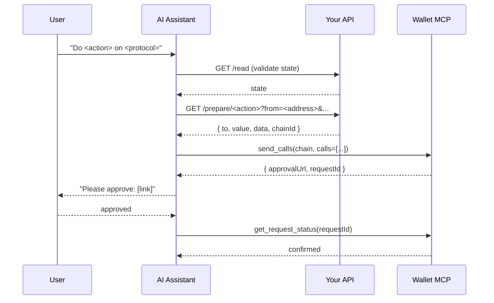

> ## Documentation Index
> Fetch the complete documentation index at: https://docs.cdp.coinbase.com/llms.txt
> Use this file to discover all available pages before exploring further.

# Build a Custom Wallet Plugin

> Prepare supported wallet actions through an API, CLI, SDK, or MCP.

## Check execution mode first

These protocol recipes describe approval-based execution unless a current tool explicitly supports the operation in your autonomous session. A plugin returning unsigned calldata does not establish that its contracts, assets, approvals, or chain satisfy autonomous spending policy.

In approval mode, show the approval link and wait before checking status. In eligible autonomous mode, use only supported bounded actions, provide required idempotency keys, and inspect returned status without inventing an approval step. Refusal is not automatic fallback. See [agent spending controls](https://docs.cdp.coinbase.com/ai-agents/coinbase-for-agents/wallet-mcp.md#agent-wallets--spending-limits) and [retry guidance](https://docs.cdp.coinbase.com/ai-agents/coinbase-for-agents/wallet-mcp.md#status-and-retries).

## Custom plugins

A plugin is a markdown spec that teaches your assistant how to call an external API, run a CLI, or call another MCP server, translate the response into a Wallet MCP action, and execute it through tools like `send_calls`, `swap`, or `sign`. The calldata-based [native plugins](https://docs.cdp.coinbase.com/ai-agents/coinbase-for-agents/wallet-mcp/plugins) follow the same shape. This page shows how to write your own `send_calls`-based plugin.

### When you need one

Write a plugin when your protocol has an HTTP tx-builder, a CLI/SDK that can produce unsigned transactions, or its own MCP server. CLI/SDK-only plugins require a harness with shell access; hybrid plugins can prefer a CLI in coding harnesses and fall back to an MCP server in chat-only Claude or ChatGPT consumer apps.

### Anatomy of a plugin

A `send_calls`-based plugin file contains four sections:

**1. Onboarding Gate**

A `STOP` notice that forces the assistant to complete Wallet MCP onboarding and execution-mode checks before doing anything else. Fetch the executing wallet address only when preparation requires it.

**2. Read Endpoints**

Document the GET endpoints or CLI commands that return state — balances, positions, market data — and the units they use.

> [!NOTE]
>
> POST endpoints are not supported in Claude and ChatGPT consumer apps.

**3. Prepare Endpoints**

Document the endpoints, CLI commands, or MCP tools that return unsigned calldata. State the exact response shape so the assistant knows which fields map to `to`, `value`, and `data`.

**4. send\_calls Mapping**

Show the assistant how to convert the prepare response into the `calls` array passed to `send_calls`.

> [!NOTE]
>
> Wallet MCP's `web_request` tool can make GET and POST requests only to allowlisted partner APIs. Native plugins that rely on HTTP hosts may be allowlisted for the hosted MCP, while CLI-only plugins require shell access unless they document an MCP fallback. Custom plugin hosts usually are not allowlisted, so custom plugins should expose GET endpoints only if they need to remain usable in Claude and ChatGPT consumer apps.

### How it works



### Build it

#### 1. Pick a response shape

Your prepare endpoint should return a single object with the fields `send_calls` needs. Two common shapes:

**Envelope** (Avantis-style):

```json Envelope Response lines wrap expandable theme={null}
{
  "ok": true,
  "data": {
    "to": "0x...",
    "value": "0x0",
    "data": "0x...",
    "chainId": 8453
  }
}
```

**Ordered batch** (Moonwell-style) — for when approval, enter-market, and the action are separate calls:

```json Ordered Batch Response theme={null}
{
  "transactions": [
    { "step": "approve", "to": "0x...", "data": "0x...", "value": "0x0", "chainId": 8453 },
    { "step": "action",  "to": "0x...", "data": "0x...", "value": "0x0", "chainId": 8453 }
  ]
}
```

Either works. The batch shape is preferable when allowance or registration steps must run before the action — `send_calls` executes them atomically in one approval.

#### 2. Write the plugin spec

Use this template as `plugins/my-protocol.md` in your skill, or as an `.mdx` page if you're publishing docs.

````markdown plugins/my-protocol.md lines wrap expandable theme={null}
# My Protocol Plugin

> Load the Wallet MCP execution-mode reference before any write. This example is approval-based. For an eligible autonomous session, use only tool-supported bounded calls with required idempotency keys, and inspect the returned status. Stop on refusal; do not silently switch wallet or mode.

> [!IMPORTANT]
> ## STOP — COMPLETE ONBOARDING BEFORE USING THIS PLUGIN
>
> Before calling any My Protocol endpoint, you MUST complete the Wallet MCP onboarding flow:
> 1. Complete detection and the disclaimer in `SKILL.md`.
> 2. Check the actual session mode and tool eligibility.
> 3. Fetch the executing wallet address when needed.
>
> Use the bound agent wallet in autonomous mode; do not substitute the main wallet.

My Protocol is a <one-line description>. Fetch unsigned calldata from the My Protocol API, then execute via Wallet MCP's `send_calls`.

**Fetching calldata:** the My Protocol API is not on the Wallet MCP `web_request` allowlist. Construct the prepare URL as a GET with all parameters in the query string. If `web_request` rejects it, fetch through whatever capability the harness exposes, or ask the user to paste the response into the chat. Then continue with `send_calls`.

**Supported chain:** Base mainnet (`8453` / `0x2105`).

---

## Read endpoints

```
GET https://api.myprotocol.xyz/v1/state/<address>
```

## Prepare endpoint

```
GET https://api.myprotocol.xyz/v1/prepare/<action>?from=<address>&amount=<decimal>
```

Response:

```json
{
  "transactions": [
    { "step": "approve", "to": "0x...", "data": "0x...", "value": "0x0", "chainId": 8453 },
    { "step": "action",  "to": "0x...", "data": "0x...", "value": "0x0", "chainId": 8453 }
  ]
}
```

## send_calls mapping

Pass every `transactions[*]` to `send_calls`:

```json
{
  "chain": "base",
  "calls": [
    { "to": "<tx.to>", "value": "<tx.value>", "data": "<tx.data>" }
  ]
}
```

## Orchestration pattern

```
1. get_wallets -> address
2. Fetch GET /state/<address> -> validate balances/preconditions
3. Fetch GET /prepare/<action>?from=<address>&amount=<decimal>
   (if web_request rejects the host, fetch directly or ask the user to paste the JSON)
4. send_calls(chain="base", calls from transactions[])
5. User approves -> get_request_status(requestId)
```
````

#### 3. Wire it into `send_calls`

The contract between your prepare endpoint and Wallet MCP is exactly this object:

```json send_calls Payload theme={null}
{
  "chain": "base",
  "calls": [
    { "to": "0x...", "value": "0x0", "data": "0x..." }
  ]
}
```

Use Wallet MCP's chain names (`base`, `base-sepolia` (only if explicitly enabled), `ethereum`, `optimism`, `polygon`, `arbitrum`, `bsc`, or `avalanche`) when calling `send_calls`. If a prepare endpoint returns a numeric or hex `chainId`, map it to the corresponding chain name before calling Wallet MCP. `value` defaults to `0x0` if omitted. The assistant calls `send_calls` once with the full batch — the user approves once, and all calls execute atomically.

### Patterns to copy

| Pattern | When to use | Example |
| - | - | - |
| Single-call envelope | One action, one tx | [Avantis](https://github.com/coinbase/agents/blob/main/skills/wallet-mcp/plugins/avantis.md) |
| Ordered batch | Approval + action must be atomic | [Moonwell](https://github.com/coinbase/agents/blob/main/skills/wallet-mcp/plugins/moonwell.md) |
| CLI-only prepared batch | Protocol CLI produces calldata; no MCP fallback needed | [Aerodrome](https://github.com/coinbase/agents/blob/main/skills/wallet-mcp/plugins/aerodrome.md) |
| CLI or MCP prepared batch | Prefer a protocol CLI when shell access exists; fall back to an MCP server on chat-only surfaces | [Morpho](https://github.com/coinbase/agents/blob/main/skills/wallet-mcp/plugins/morpho.md) |
| Multi-endpoint flow | Quote, approve, swap as separate calls | [Uniswap](https://github.com/coinbase/agents/blob/main/skills/wallet-mcp/plugins/uniswap.md) |
| Discovery API + swap | Read-only feed selects the token; `swap` executes the purchase | [Bankr](https://github.com/coinbase/agents/blob/main/skills/wallet-mcp/plugins/bankr.md) |
| MCP server + SIWE session auth | Protocol has its own MCP server; Wallet MCP wallet signs the login challenge | [Virtuals](https://github.com/coinbase/agents/blob/main/skills/wallet-mcp/plugins/virtuals.md) |

## What to read next

* [Wallet MCP overview](https://docs.cdp.coinbase.com/ai-agents/coinbase-for-agents/wallet-mcp.md)
* [Networks and availability](https://docs.cdp.coinbase.com/ai-agents/coinbase-for-agents/wallet-mcp.md#networks)
* [Track actions and retry safely](https://docs.cdp.coinbase.com/ai-agents/coinbase-for-agents/wallet-mcp.md#status-and-retries)
