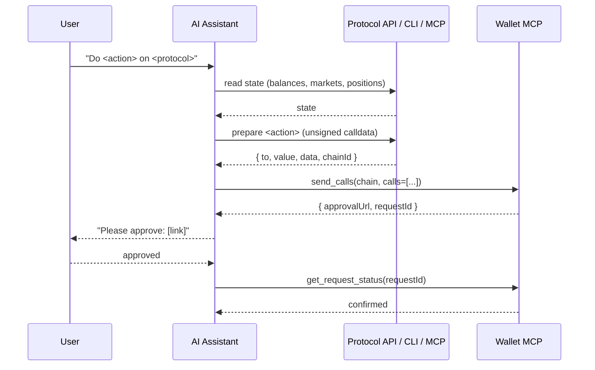

> ## Documentation Index
> Fetch the complete documentation index at: https://docs.cdp.coinbase.com/llms.txt
> Use this file to discover all available pages before exploring further.

# Use Native Wallet Plugins

> Use 20 protocol plugins with the right client and execution mode.

## Check execution mode first

The 20 native plugins document approval-based sign-in, wallet-specific preparation, and write/payment workflows. Autonomous sessions must stop before those unverified workflows and must not substitute an agent-wallet identity.

Explicitly documented public, read-only discovery can run in either mode when it requires no wallet identity, authentication, signature, preparation, payment, or other side effect. For example, Bankr's public token-launch feed does not require wallet access. This does not imply autonomous trading support.

## Plugins

> [!TIP]
>
> This page describes how the Wallet MCP Skill and Plugins work under the hood. If you just want to install it in Claude Desktop, ChatGPT, Cursor, or Claude Code, head to the [Quickstart](https://docs.cdp.coinbase.com/ai-agents/coinbase-for-agents/wallet-mcp.md#quickstart).

### Why a skill on top of the MCP server

The MCP server exposes capabilities. Without context, models might get confused, calling write tools without warning the user, skipping approval, inventing parameters, or failing to detect that the server isn't connected at all. The skill closes that gap. Specifically, `SKILL.md` adds:

* **Detection and onboarding** — the assistant can call `get_wallets` when it needs wallet context, supported chains, or an address for a write flow.
* **Approval mode** — write tools (`send`, `swap`, `sign`, `send_calls`) return `{ approvalUrl, requestId }`. The skill tells the model to present the link, wait, then poll `get_request_status` — never to claim success before confirmation.
* **Tone rules** — load-bearing language conventions (e.g. "onchain", never "web3") and a beginner/sophisticated detection heuristic so responses match the user.
* **Plugin patterns** — documented prepare → `send_calls`, `swap`, and `sign` patterns that let external protocols extend the skill without modifying the MCP server.

### How SKILL.md is loaded

Skills use progressive disclosure. The model loads `SKILL.md` at session start (cheap — \~100 lines) and reads `references/*.md` and `plugins/*.md` only when a relevant task arises.

The shape of the Wallet MCP skill:

**skills/base-mcp**

**SKILL.md**

**references**

**install.md**

**tone.md**

**approval-mode.md**

**execution-modes.md**

**batch-calls.md**

**custom-plugins.md**

**plugin-spec.md**

**plugins**

**aerodrome.md**

**avantis.md**

**balancer.md**

**bankr.md**

**bitrefill.md**

**brickken.md**

**clawnch.md**

**flaunch.md**

**gmgn.md**

**hydrex.md**

**kyberswap.md**

**moonwell.md**

**morpho.md**

**o1-exchange.md**

**opensea.md**

**printr.md**

**uniswap.md**

**venice.md**

**virtuals.md**

**yo.md**

`SKILL.md` itself defines the session flow, approval handling, and plugin routing. The MCP tool descriptions are the source of truth for core tool parameters; plugin specs are loaded only when a relevant task arises, such as loading `plugins/morpho.md` for a Morpho vault request.

Read the canonical file at [`skills/wallet-mcp/SKILL.md`](https://github.com/coinbase/agents/blob/main/skills/wallet-mcp/SKILL.md).

### How plugins extend the skill

A plugin is a markdown spec — one file in `plugins/` — that teaches the assistant how to drive an external protocol with Wallet MCP. Most onchain-action plugins prepare unsigned calldata and execute it through `send_calls`; others use a core tool such as `swap` or `sign`.

For calldata-based plugins, the contract is the same whether the protocol exposes an HTTP tx-builder, a CLI, or its own sibling MCP server:



Most calldata-based plugin files follow the same four-section shape:

**1. Onboarding Gate**

A `STOP` notice forcing the assistant to complete Wallet MCP detection and onboarding before touching the plugin's tools.

**2. Read Endpoints**

The GET endpoints, CLI commands, or read tools that return state — balances, positions, market data.

**3. Prepare Endpoints**

The endpoints, CLI commands, or `prepare_*` tools that return unsigned calldata, with the exact response shape so the model knows which fields map to `to`, `value`, and `data`.

**4. send\_calls Mapping**

How to turn the prepare response into the `calls` array passed to Wallet MCP's `send_calls`.

Wallet MCP passes the calldata to Coinbase Wallet for user approval. The protocol never touches private keys.

### Native plugins

Native plugins ship with the Wallet MCP skill and live alongside `SKILL.md` in [`github.com/coinbase/agents`](https://github.com/coinbase/agents/tree/main/skills/wallet-mcp/plugins). The assistant loads the relevant plugin spec on demand.

Most transaction plugins follow the prepare -> `send_calls` pattern described in the [Overview](https://docs.cdp.coinbase.com/ai-agents/coinbase-for-agents/wallet-mcp/plugins). Some plugins use Wallet MCP semantic tools instead: Bankr, Clawnch, and Flaunch use `swap` for token buys; Bitrefill uses `sign`, x402 tools, and `send`; Venice uses `sign` and x402 for wallet-funded inference; Virtuals uses `sign` for SIWE login; YO uses `chain_rpc_request` for reads before `send_calls`. The plugin spec is the single source of truth; the cards below are pointers, not duplicates.

> [!NOTE]
>
> Aerodrome, Balancer, and GMGN are CLI-only and require shell or terminal
> access. They do not run from chat-only surfaces such as ChatGPT or Claude.ai.
>
> Some plugins are environment-aware:
>
> * Avantis splits by capability: view-only reads work everywhere via `web_request`; tx-builder calls run from a CLI harness, with an Avantis web UI fallback on chat-only surfaces.
> * Bitrefill supports wallet-native commerce by default and optional CLI or MCP paths for existing Bitrefill accounts.
> * Morpho uses CLI when shell access exists, otherwise uses Morpho MCP.
> * OpenSea can use its REST API directly or its CLI when shell access exists.
> * Venice supports API-key inference and a Base-wallet x402 path.
> * Virtuals requires installing an MCP server and running the auth flow once per session.

#### Using a native plugin

**1. Install the Skill**

Connect `wallet-mcp.coinbase.com` and load the skill in your client. See the [Quickstart](https://docs.cdp.coinbase.com/ai-agents/coinbase-for-agents/wallet-mcp.md#quickstart) for Claude, Claude Desktop, ChatGPT, Cursor, Claude Code, and Codex.

**2. Prompt the Assistant**

Just describe what you want. The assistant pulls the relevant plugin spec into context automatically.

```text Morpho theme={null}
Find the best USDC vault on Base by APY and deposit 100 USDC
```

```text KyberSwap theme={null}
Swap 100 USDC to ETH on Base at the best available rate
```

```text Bitrefill theme={null}
Buy me a $25 Amazon US gift card with USDC on Base
```

```text Flaunch theme={null}
Launch a memecoin on Base
```

**3. Approve**

For onchain actions, the plugin prepares a Wallet MCP `send_calls`, `swap`, `send`, x402, or `sign` request. Open the approval link, review the action in Coinbase Wallet, approve, and prompt the assistant again so it can poll `get_request_status` until confirmed.

> [!NOTE]
>
> Plugins that use `web_request` only reach protocols whose hostnames are on the
> Wallet MCP allowlist. CLI-only plugins use the harness shell instead of
> `web_request`. To call a protocol that isn't allowlisted, see [Build a custom
> plugin](https://docs.cdp.coinbase.com/ai-agents/coinbase-for-agents/wallet-mcp/custom-plugins).

#### Aerodrome

The Aerodrome plugin covers token swaps and basic-pool (vAMM/sAMM) liquidity provision on Base. It uses the [Velodrome sugar-sdk](https://github.com/velodrome-finance/sugar-sdk) Python library locally to discover pools, build swap routes, and prepare deposit/withdraw/stake/claim calldata. Calldata is then submitted through Wallet MCP's `send_calls` for user approval.

**Chain:** Base mainnet.

**Operations:** swap quote/execute (basic pools), basic pool deposit/withdraw, position queries, gauge stake/unstake, claim emissions/fees.

> [!WARNING]
>
> **CLI-only plugin.** This plugin runs Python locally via a Bash/shell tool. It works in **Claude Code, Codex, Cursor terminal**, and similar CLI harnesses — it does **not** work in chat-only environments (ChatGPT, Claude.ai) because there's no shell to run sugar-sdk in.

##### Try it

```text Swap theme={null}
Swap 0.001 ETH for USDC on Aerodrome
```

```text Provide liquidity theme={null}
Add 0.001 ETH and matching USDC to the vAMM-WETH/USDC pool on Aerodrome
```

```text Withdraw theme={null}
Withdraw all my Aerodrome basic LP positions
```

##### Pattern

sugar-sdk's write methods (`swap_from_quote`, `deposit`, `withdraw`, `stake`, `claim_emissions`) normally sign and broadcast transactions with a local private key. The plugin monkey-patches `sign_and_send_tx` to capture the unsigned `{to, data, value}` instead, then passes the captured calls to Wallet MCP's `send_calls` for user approval. The same bridge handles ERC-20 approvals (USDC/WETH), Universal Router swap execution, and Router LP operations.

> [!NOTE]
>
> The public `https://mainnet.base.org` RPC enforces a 10-call-per-batch limit and rate-limits concurrent batches, which breaks sugar-sdk's default `asyncio.gather` pagination. The plugin reference includes a `patches.py` that switches to sequential batching to work around this. For production usage prefer a paid RPC (Alchemy, QuickNode).

##### Reference

> [card] [Full Plugin Spec on GitHub](https://github.com/coinbase/agents/blob/main/skills/wallet-mcp/plugins/aerodrome.md)
>
> Setup, RPC compatibility patches, calldata-bridge code, swap/LP orchestration patterns, and what works vs. what doesn't on the public RPC.

#### Avantis

Avantis is a perpetual futures DEX on Base mainnet. The plugin reads market data, positions, and PnL from `data.avantisfi.com`, `core.avantisfi.com`, and `api.avantisfi.com` (allowlisted for Wallet MCP `web_request`), and builds unsigned trade calldata from `tx-builder.avantisfi.com` for execution through Wallet MCP's `send_calls`. Collateral is USDC; ETH is used only for gas and execution fees.

**Chain:** Base mainnet.

**Operations:** open trade (market, limit, stop-limit, zero-fee), close, cancel, update margin, set TP/SL, approve USDC, set/remove delegate, plus reads for pairs, positions, limit orders, and PnL history.

##### Surface routing

> [card] Reads Work Everywhere
>
> Pair info, leverage rules, fees, open positions, limit orders, and PnL history are fetched through Wallet MCP `web_request` on chat-only surfaces (ChatGPT, Claude.ai) or directly via the harness HTTP tool in Claude Code, Codex, and Cursor terminal.

> [card] Trade-Building Splits by Surface
>
> In CLI harnesses, the plugin calls the Avantis tx-builder and submits unsigned calldata through `send_calls`. On chat-only surfaces, it links the user to the Avantis web UI for the relevant pair instead.

> [!NOTE]
>
> Only `tx-builder.avantisfi.com` is gated to CLI harnesses. View-only Avantis APIs (`data`, `core`, `history`) are on the Wallet MCP `web_request` allowlist and work on every supported surface.

##### Try it

```text Read pairs and PnL (any surface) theme={null}
What's my Avantis open positions and PnL on Base?
```

```text Open long (CLI harness) theme={null}
Open a 10x long BTC/USD with 100 USDC collateral on Avantis
```

```text Limit order (CLI harness) theme={null}
Place a limit long on ETH/USD at 3000 with 50 USDC at 5x
```

```text Manage trade (CLI harness) theme={null}
Close my BTC/USD position on Avantis
```

```text Chat-only fallback theme={null}
Take me to the ETH/USD market on Avantis
```

When the request needs tx-builder calldata and the current surface is chat-only, the assistant summarizes what you'd be signing and hands you a deep link of the form `https://www.avantisfi.com/trade?asset=<SYMBOL>-USD` (for example, `https://www.avantisfi.com/trade?asset=ETH-USD`) to complete the trade in the Avantis UI.

##### Pattern

Every prepare endpoint returns a single-call envelope (`{ ok, data: { to, value, data, chainId } }`) that maps to a Wallet MCP `send_calls` call with `chain: "base"`. Approval and trade can be batched into one approval. The plugin reads `/v2/trading` to validate pair, leverage, and minimum notional before building the open call, and reads `core /user-data` to resolve real position/order indices for management actions.

> [!NOTE]
>
> No additional MCP server is required. View-only Avantis APIs are reached through Wallet MCP `web_request` on chat-only surfaces (or directly from the harness shell in CLI environments). Tx-builder calldata is built and submitted from CLI harnesses; on chat-only surfaces the assistant links to the Avantis UI instead.

##### Reference

> [card] [Full Plugin Spec on GitHub](https://github.com/coinbase/agents/blob/main/skills/wallet-mcp/plugins/avantis.md)
>
> Endpoint inventory, parameters, unit/scaling rules, batching guidance, chat-only UI fallback, and error handling.

#### Balancer

Balancer is an automated market maker for token swaps and liquidity provision. The plugin reads pool data and Smart Order Router quotes from the Balancer API, builds unsigned calldata with `@balancer/sdk`, and submits the resulting calls through Wallet MCP `send_calls`.

**Chains:** Base, Ethereum, Arbitrum, Optimism, and Avalanche.

**Operations:** pool discovery, swap quotes, swap execution, add liquidity, remove liquidity, and version-aware approval batching.

> [!TIP]
>
> **CLI-only plugin.** Balancer requires shell access for both reads and calldata building. It works in CLI harnesses such as Claude Code, Codex, and Cursor terminal, and does not run from chat-only surfaces.

##### Install Balancer SDK Tooling

Use a working directory with Node available:

```bash Terminal theme={null}
npm init -y
npm i @balancer/sdk viem
export RPC_URL="<a Base RPC HTTPS endpoint>"
```

The SDK simulation needs an RPC URL. The plugin spec includes the Node scripts and approval rules needed to emit Wallet MCP-ready calls.

##### Try it

```text Swap theme={null}
Swap 100 USDC for WETH on Base through Balancer
```

```text Find yield theme={null}
What's the best Balancer pool for ETH yield on Base?
```

```text Add liquidity theme={null}
Add 500 USDC and 0.2 WETH to a Balancer pool on Base
```

##### Pattern

The assistant fetches Balancer SOR paths with the API, then runs the SDK script to produce `{ chain, protocolVersion, minAmountOut, calls }`. For v2 routes, the batch includes ERC-20 approval to the Balancer Vault plus the Vault call. For v3 routes, it includes ERC-20 approval to Permit2, Permit2 approval to the router, then the router call. Native ETH input omits approvals and carries ETH in `value`.

The emitted `calls` array maps directly to Wallet MCP `send_calls`. The assistant reviews output, shows the approval link, and polls `get_request_status` after approval.

##### Reference

> [card] [Full Plugin Spec on GitHub](https://github.com/coinbase/agents/blob/main/skills/wallet-mcp/plugins/balancer.md)
>
> Shell setup, GraphQL queries, SDK scripts, v2/v3 approval rules, and risk handling.

#### Bankr

The Bankr plugin uses the [Bankr](https://bankr.bot) public API to surface the latest deployed token launches on Base, then routes the actual purchase through Wallet MCP's `swap` tool. Bankr is the discovery layer; the swap is a regular `swap` call paying ETH (or USDC) for the target ERC-20.

**Chain:** Base mainnet.

**Operations:** list latest launches, filter by deployer or recency, and buy a chosen token with `swap`.

##### Try it

```text Browse theme={null}
Show me the latest token launches on Base
```

```text Filter theme={null}
Are there any launches from @0xtinylabs in the last hour?
```

```text Buy theme={null}
Buy 0.001 ETH worth of the newest token on Bankr
```

##### Pattern

The plugin makes one `web_request` to `https://api.bankr.bot/token-launches` for the discovery feed, filters/presents the results client-side, and waits for the user to pick a token and amount. The buy itself is a single Wallet MCP `swap` call (`fromAsset` as `ETH` or `USDC`, `toAsset` as the launch token address) — same approval flow as any other write.

> [!WARNING]
>
> The Bankr feed is unfiltered. Listed tokens are not vetted, audited, or endorsed by Base — many are low-liquidity meme launches. Always confirm symbol, address, and amount with the user before swapping.

> [!NOTE]
>
> `api.bankr.bot` must be on the Wallet MCP `web_request` allowlist. If a request is rejected, fall back to the harness's HTTP/fetch tool if one is available.

##### Reference

> [card] [Full Plugin Spec on GitHub](https://github.com/coinbase/agents/blob/main/skills/wallet-mcp/plugins/bankr.md)
>
> API response shape, orchestration steps, symbol-collision and adversarial-metadata safety notes for new launches.

#### Bitrefill

Bitrefill turns USDC on Base into everyday digital goods inside the conversation: gift cards, mobile refills, and travel eSIMs. The default path signs in once with the user's Base wallet, searches the catalog, creates an order, pays with USDC, then returns fulfillment details in chat.

**Chain:** Base mainnet.

**Operations:** catalog search, product details, checkout, invoice status, x402 payment, direct USDC payment for existing-account flows, and code or eSIM delivery.

> [!TIP]
>
> **Wallet sign-in and bearer credentials.** The default flow uses SIWX/SIWE with Wallet MCP `sign`. Redemption codes, eSIM links, JWTs, and invoice details are sensitive and should only be shown when needed.

##### Install Bitrefill MCP for Existing Accounts

The default agent-commerce path uses Wallet MCP and the Bitrefill HTTP API. Existing Bitrefill account users can also connect the Bitrefill MCP:

```bash Terminal theme={null}
claude mcp add bitrefill --url https://api.bitrefill.com/mcp
```

Keep `buy-products` out of auto-approval. The plugin also supports `npx @bitrefill/cli@latest` in shell-capable harnesses.

##### Try it

```text Gift card theme={null}
Buy me a $25 Amazon US gift card with USDC on Base
```

```text Browse theme={null}
Show me Steam gift cards available in the US
```

```text Existing account theme={null}
Use my existing Bitrefill account to buy a travel eSIM
```

##### Pattern

Bitrefill uses Wallet MCP for `web_request`, `sign`, x402 payments, and direct `send` of USDC. It does not use `send_calls`. The assistant signs the SIWX payload, uses the returned JWT for catalog and checkout calls, confirms product, denomination, and total price, then pays the Base USDC x402 requirement or direct invoice destination.

After payment, the assistant polls status and returns fulfillment data carefully because codes and QR links are bearer credentials.

##### Reference

> [card] [Full Plugin Spec on GitHub](https://github.com/coinbase/agents/blob/main/skills/wallet-mcp/plugins/bitrefill.md)
>
> Path selection, SIWX headers, x402 payments, account connector setup, and fulfillment safety notes.

#### Brickken

Brickken provides ERC-8004 identity, reputation, and agent-token operations. The plugin prepares operations through Brickken MCP tools, the hosted Brickken MCP HTTP API, or the Brickken CLI, then uses Wallet MCP for x402 approval and completion.

**Chains:** Base mainnet and Base Sepolia.

**Operations:** agent registration, identity updates, reputation operations, agent wallet changes, agent token operations, and ownership transfer.

> [!TIP]
>
> Brickken initially operates in `brickken-relayed` mode. Changing the agent wallet only changes the operational wallet; transferring the ERC-721 identity requires an explicit ownership transfer.

##### Install Brickken Tooling

Optional MCP connector:

```bash Terminal theme={null}
claude mcp add --transport http brickken https://mcp.brickken.com/mcp
```

CLI-capable harnesses can also use:

```bash Terminal theme={null}
npx brickken-cli --help
```

##### Try it

```text Register theme={null}
Register my agent on Base
```

```text Agent wallet theme={null}
Set my Base wallet as the agent wallet
```

```text Transfer identity theme={null}
Send the agent NFT to my Base wallet
```

##### Pattern

Brickken prepare surfaces return a `txId`, transactions, and x402 requirements. The assistant maps the quoted price to `initiate_x402_request.maxPayment`, sends the `txId` and prepared transactions in the x402 request body, waits for Coinbase Wallet approval, then calls `complete_x402_request`.

Brickken's relayer is the onchain sender; the Coinbase Wallet is the x402 payer.

##### Reference

> [card] [Full Plugin Spec on GitHub](https://github.com/coinbase/agents/blob/main/skills/wallet-mcp/plugins/brickken.md)
>
> Hosted MCP API shape, CLI path, x402 mapping, custody notes, and operation inventory.

#### Clawnch

Clawnch is a Base token launch and discovery surface. The plugin reads recent launches and top-volume tokens from the Clawnch public API, routes buys through Wallet MCP `swap`, and prepares non-custodial Clanker launch calldata for Wallet MCP `send_calls`.

**Chain:** Base mainnet.

**Operations:** recent launch discovery, top-volume discovery, token lookup, token buys, CLAWNCH burns, and token launch preparation.

> [!TIP]
>
> Newly launched tokens can be illiquid or unsafe. The assistant should never auto-buy from discovery results; it confirms symbol, address, funding asset, and amount first.

##### Try it

```text Latest launches theme={null}
Show me the latest token launches on Clawnch
```

```text Buy theme={null}
Buy 0.001 ETH worth of the top volume token on Clawnch
```

```text Launch theme={null}
Launch a token called "Cool Project" with symbol COOL
```

##### Pattern

Discovery uses Clawnch GET endpoints through `web_request` or a harness HTTP tool. Buys map to Wallet MCP `swap` with `chain: "base"`, `fromAsset` as `ETH` or `USDC`, and `toAsset` as the discovered token contract.

Launches call `/api/prepare/deploy`, then map the returned `data` object directly into `send_calls`: `{ chain: "base", calls: [{ to, value, data }] }`. The assistant shows launch details and only submits after confirmation.

##### Reference

> [card] [Full Plugin Spec on GitHub](https://github.com/coinbase/agents/blob/main/skills/wallet-mcp/plugins/clawnch.md)
>
> API endpoints, launch feeds, buy flow, deploy preparation, burn/vault flow, and risk checks.

#### Flaunch

Flaunch is a token launch and discovery surface for Base memecoins. The plugin uses `mcp.flaunch.gg` to upload media, prepare launch metadata, discover launched coins, and build Base-compatible transaction previews. Wallet MCP handles the approval and submission.

**Chain:** Base mainnet.

**Operations:** media upload, token launch preparation, new coin discovery, token lookup, token buys, and token sells.

> [!TIP]
>
> Launches and swaps are irreversible. New tokens can have thin liquidity, so the assistant confirms token details and slippage-sensitive trades before calling Wallet MCP tools.

##### Try it

```text Launch theme={null}
Launch a memecoin on Base
```

```text Discover theme={null}
Show me the newest Flaunch coins
```

```text Buy theme={null}
Buy 0.001 ETH of a Flaunch coin
```

##### Pattern

For launches, the assistant confirms name, symbol, description, image, creator address, and social URLs, then calls `POST /v1/base/launch/prepare`. The returned `input` is already in Wallet MCP `send_calls` shape.

For deployed token trades, the assistant resolves the token address from Flaunch discovery or user input and uses Wallet MCP `swap` with `chain: "base"`. If `swap` cannot route the token, the assistant stops instead of inventing raw calldata.

##### Reference

> [card] [Full Plugin Spec on GitHub](https://github.com/coinbase/agents/blob/main/skills/wallet-mcp/plugins/flaunch.md)
>
> Launch preparation, media upload, discovery endpoints, swap mapping, and risk checks.

#### GMGN

GMGN provides token swap routing and onchain market intelligence for Base. The plugin calls the GMGN HTTP API to obtain unsigned swap calldata, gas-price tiers, and trending token data, then submits prepared swap calls through Wallet MCP `send_calls`.

**Chain:** Base mainnet.

**Operations:** swap quotes, ERC-20 approval calls, swap execution, gas-price reads, trending-token reads, and market-intelligence summaries.

> [!TIP]
>
> **CLI-only and API-key authenticated.** Every GMGN request needs a fresh shell-generated timestamp and UUID plus the `X-APIKEY` header. Confirm slippage and inspect low-liquidity tokens before swaps.

##### Try it

```text Swap ETH theme={null}
Swap 0.00001 ETH for a token on Base
```

```text Swap USDC theme={null}
Swap 100 USDC for ETH on Base
```

```text Trending theme={null}
Show trending tokens on Base
```

##### Pattern

The assistant generates auth parameters with shell commands, fetches a GMGN quote, shows expected output and minimum output, then builds a `send_calls` batch from `data.tx.approve_txs` followed by the swap call `{ to: data.tx.to, value: data.tx.value, data: data.tx.data }`.

Native ETH inputs usually have no approval calls. ERC-20 inputs include the returned approval transaction before the swap. The assistant polls `get_request_status` only after Coinbase Wallet approval.

##### Reference

> [card] [Full Plugin Spec on GitHub](https://github.com/coinbase/agents/blob/main/skills/wallet-mcp/plugins/gmgn.md)
>
> Auth parameters, quote endpoint, gas-price endpoint, trending-token endpoint, calldata mapping, and risk notes.

#### Hydrex

Hydrex is an Omni-Liquidity MetaDEX on Base. The plugin calls the Hydrex prepare server for quotes, portfolio state, pool data, and unsigned transaction calldata, then submits swaps and liquidity actions through Wallet MCP `send_calls`.

**Chain:** Base mainnet.

**Operations:** swap quotes, swaps, position reads, pool discovery, add liquidity, remove liquidity, and portfolio summaries.

> [!TIP]
>
> On chat-only surfaces, the Hydrex prepare server may require a user-paste fallback: the assistant constructs a full GET URL, the user opens it, and the pasted JSON is mapped into `send_calls`.

##### Try it

```text Swap theme={null}
Swap 5 USDC for ETH on Hydrex
```

```text Positions theme={null}
Show my Hydrex liquidity positions
```

```text Add liquidity theme={null}
Add liquidity to the USDC/ETH pool on Hydrex: 100 USDC and 0.04 ETH
```

##### Pattern

Prepare endpoints return a `transactions[]` array. The assistant maps every transaction into one Wallet MCP `send_calls` batch with `{ to, value, data }` and `chain: "base"`. Approvals and actions stay in response order so the batch executes atomically.

Reads and prepare calls need the user's wallet address as `from` or `recipient`. For liquidity actions, the assistant shows tick range, amounts, and position details before asking for approval.

##### Reference

> [card] [Full Plugin Spec on GitHub](https://github.com/coinbase/agents/blob/main/skills/wallet-mcp/plugins/hydrex.md)
>
> State endpoints, prepare endpoints, position handling, transaction mapping, and chat-only fallback.

#### KyberSwap

KyberSwap is a DEX aggregator that routes trades across 50+ liquidity sources. The plugin fetches a route quote, builds unsigned calldata with the KyberSwap Aggregator API, and submits the swap through Wallet MCP `send_calls`.

**Chains:** Base, Ethereum, Arbitrum, Optimism, Polygon, BSC, and Avalanche.

**Operations:** token resolution, best-route quotes, swap calldata building, ERC-20 approvals, and native-token swaps.

> [!TIP]
>
> **Multi-chain swaps.** Use chain name strings such as `base`, `arbitrum`, or `polygon`, not numeric chain IDs. Quotes can move, so the assistant confirms output, gas, and slippage first.

##### Try it

```text Base swap theme={null}
Swap 100 USDC to ETH on Base
```

```text Arbitrum swap theme={null}
Swap 0.1 ETH to USDC on Arbitrum
```

```text Read-only quote theme={null}
What's the best rate to swap 500 MATIC to USDC on Polygon?
```

##### Pattern

The assistant calls `GET /api/v1/routes`, shows the quoted output and gas, then calls `POST /api/v1/route/build` with the returned `routeSummary`. Native-token input maps to one router call. ERC-20 input batches an ERC-20 `approve` call before the router call.

`transactionValue` is returned as decimal wei and must be hex-encoded for Wallet MCP `send_calls`.

##### Reference

> [card] [Full Plugin Spec on GitHub](https://github.com/coinbase/agents/blob/main/skills/wallet-mcp/plugins/kyberswap.md)
>
> Route API, build API, chain slugs, approval encoding, and send\_calls mapping.

#### Moonwell

Moonwell is a Compound v2 lending protocol on Base and Optimism. The plugin reads positions and rates from `api.moonwell.fi` and prepares unsigned calldata that Wallet MCP executes atomically through `send_calls` — including the `approve` and `enter-market` steps that precede each action.

**Chains:** Base (8453), Optimism (10).

**Operations:** supply, withdraw, borrow, repay, plus reads for markets, rates, positions, health, rewards, and token balances.

##### Try it

```text Supply theme={null}
Supply 100 USDC on Moonwell
```

```text Borrow theme={null}
Borrow 500 USDC against my collateral on Moonwell
```

```text Health check theme={null}
What's my Moonwell health factor on Base?
```

##### Pattern

The Moonwell API returns an ordered `transactions[]` array — `approve`, `enter-market`, then the protocol action. The plugin maps all entries into a single `send_calls` batch so the user approves once.

> [!NOTE]
>
> `api.moonwell.fi` must be on the Wallet MCP `web_request` allowlist. It already is for the hosted MCP at `wallet-mcp.coinbase.com`.

##### Reference

> [card] [Full Plugin Spec on GitHub](https://github.com/coinbase/agents/blob/main/skills/wallet-mcp/plugins/moonwell.md)
>
> Endpoint inventory, response shapes, mToken notes, and health factor guide.

#### Morpho

Morpho is a lending protocol on Base. The plugin chooses the right execution path for the current environment: use the Morpho CLI (`npx @morpho-org/cli@latest`) in CLI-capable harnesses, and use the Morpho MCP server (`https://mcp.morpho.org/`) when the user is in a chat-only Claude or ChatGPT-style surface. Wallet MCP's `send_calls` wraps prepared transactions into a single user approval.

**Chain:** Base mainnet.

**Operations:** deposit, withdraw, supply, borrow, repay, supply/withdraw collateral, plus reads for vaults, markets, and positions.

> [!TIP]
>
> **Environment-aware plugin.** If the harness has shell or terminal access, use Morpho CLI. If it does not, use already connected Morpho MCP tools, or help the user install Morpho MCP for Claude or ChatGPT.

##### Install Morpho MCP When No CLI Is Available

Claude / Claude Desktop: Customize → Connectors → Add custom connector, name `morpho`, URL `https://mcp.morpho.org/`.

ChatGPT: Settings → Connectors → Create, name `morpho`, MCP Server URL `https://mcp.morpho.org/`, Authentication `OAuth`.

##### Try it

```text Find a vault theme={null}
Find the best USDC vault on Base by APY and deposit 100 USDC
```

```text Check positions theme={null}
Show all my Morpho positions on Base
```

```text Health check theme={null}
Check if my Morpho borrow position is healthy
```

##### Pattern

In CLI-capable harnesses, run Morpho CLI:

```bash Terminal theme={null}
npx @morpho-org/cli@latest query-vaults --chain base --asset-symbol USDC --sort apy_desc --limit 5
npx @morpho-org/cli@latest prepare-deposit --chain base --vault-address 0x... --user-address 0x... --amount 100
```

In chat-only harnesses, use Morpho MCP tools for the same vault/market reads and prepare actions. The assistant reviews the CLI JSON or MCP response (`summary`, `transactions`/`calls`, simulation status, `outcome`, and `warnings`), passes the unsigned calls to Wallet MCP `send_calls` with `chain: "base"`, and polls `get_request_status` once you approve in Coinbase Wallet.

##### Reference

> [card] [Full Plugin Spec on GitHub](https://github.com/coinbase/agents/blob/main/skills/wallet-mcp/plugins/morpho.md)
>
> Environment detection, CLI and MCP paths, response shapes, safety checks, and orchestration details.

#### o1.exchange

o1.exchange is a trading API for token swaps on Base and BSC with optional Permit2 gasless approvals. The plugin builds unsigned transaction data over HTTP and submits standard swaps through Wallet MCP `send_calls`.

**Chains:** Base and BSC.

**Operations:** buy orders, sell orders, pool-targeted swaps, tight-slippage swaps, standard `send_calls` execution, and Permit2 private-relay completion.

> [!TIP]
>
> o1.exchange uses a pre-configured shared API token. Standard swaps submitted via `send_calls` use the public mempool; only the Permit2 `/order/complete` path uses the private relay.

##### Try it

```text Buy theme={null}
Buy 100 USDC worth of a token on Base
```

```text Sell theme={null}
Sell tokens on Base
```

```text Tight slippage theme={null}
Buy a token with tight slippage
```

##### Pattern

For standard swaps, the assistant posts to `/order`, RLP-decodes each `transactions[].unsigned` value, strips everything except `to`, `data`, and `value`, then passes the ordered calls to Wallet MCP `send_calls`. `networkId` `8453` maps to `base`; `56` maps to `bsc`.

Permit2 swaps use the plugin's `/order/complete` flow instead of `send_calls` because the server re-encodes signatures and broadcasts through the private relay.

##### Reference

> [card] [Full Plugin Spec on GitHub](https://github.com/coinbase/agents/blob/main/skills/wallet-mcp/plugins/o1-exchange.md)
>
> Order parameters, RLP decoding, Permit2 flow, MEV notes, and chain mapping.

#### OpenSea

OpenSea is an NFT marketplace and token trading platform. The plugin covers token swaps, NFT drops and minting, and marketplace trading, fetching unsigned calldata from the OpenSea REST API or CLI and submitting transactions through Wallet MCP `send_calls`.

**Chains:** Ethereum, Base, Polygon, Arbitrum, Optimism, and Avalanche.

**Operations:** token swaps, NFT best-listing reads, NFT purchases, cross-chain fulfillment, listing flows, drops discovery, and minting.

> [!TIP]
>
> **API key required.** The assistant creates or uses an OpenSea API key before calling endpoints. NFT trades and swaps are irreversible, so collection, token ID, payment token, price, and chain are confirmed first.

##### Install OpenSea CLI

Shell-capable harnesses can use the OpenSea CLI:

```bash Terminal theme={null}
npx @opensea/cli@latest --help
```

The REST API path is also supported when `api.opensea.io` is reachable and an API key is available.

##### Try it

```text Swap theme={null}
Swap 0.02 ETH for USDC on Base
```

```text Buy NFT theme={null}
Buy a Bored Ape on Ethereum
```

```text Drops theme={null}
What drops are coming up on Base?
```

##### Pattern

The assistant creates or loads an API key, gets the wallet address, then calls OpenSea API or CLI commands for quotes, listings, drops, or fulfillment data. OpenSea write responses contain unsigned transaction objects. The assistant converts decimal `value` fields to hex, maps each transaction to `{ to, value, data }`, and submits `send_calls` on the matching chain.

Cross-chain fulfillment may require multiple transactions on different chains. Those are submitted in order, waiting for confirmation before the next step.

##### Reference

> [card] [Full Plugin Spec on GitHub](https://github.com/coinbase/agents/blob/main/skills/wallet-mcp/plugins/opensea.md)
>
> API key flow, CLI usage, swaps, drops, NFT fulfillment, value conversion, and risk checks.

#### Printr

Printr is a cross-chain token launchpad where a creator deploys a token and seeds initial liquidity in one transaction. The plugin quotes launch cost, builds unsigned creation calldata through Printr's HTTP API, and submits the result with Wallet MCP `send_calls`.

**Chains:** Base, Arbitrum, Optimism, Polygon, BSC, Avalanche, and Ethereum.

**Operations:** launch quotes, token creation, deployment status checks, cross-chain launch setup, and initial-buy configuration.

> [!TIP]
>
> **Multi-chain launchpad.** Printr uses CAIP chain identifiers in API payloads, then maps returned payloads back to Wallet MCP chain names for `send_calls`.

##### Try it

```text Launch theme={null}
Launch a memecoin called Doge Supreme (DSUP) on Base
```

```text Quote theme={null}
What would it cost to launch on Base and Arbitrum?
```

```text Status theme={null}
Did my token deploy on every chain?
```

##### Pattern

The assistant calls `/print/quote` first, shows per-chain and combined launch cost, then calls `/print` only after confirmation and valid token metadata. The returned `payload.to` includes a CAIP chain prefix, `payload.calldata` is base64, and `payload.value` is decimal wei.

The assistant strips the `eip155:<chainId>:` prefix from `to`, base64-decodes calldata to hex, converts value to hex, maps the chain ID to a Wallet MCP chain string, and submits `send_calls`.

##### Reference

> [card] [Full Plugin Spec on GitHub](https://github.com/coinbase/agents/blob/main/skills/wallet-mcp/plugins/printr.md)
>
> Quote schema, print schema, payload transforms, supported chains, and token metadata constraints.

#### Uniswap

The Uniswap plugin covers token swaps (proxy-approval flow, no Permit2 signing) and LP position management for V2, V3, and V4 on Base. It fetches unsigned calldata from Uniswap's trade and liquidity APIs and executes it through Wallet MCP's `send_calls`.

**Chain:** Base mainnet.

**Operations:** swap quote/approval/execute; create, increase, decrease V3/V4 positions; create V2 positions; collect LP fees.

##### Try it

```text Swap theme={null}
Swap 100 USDC for ETH on Base
```

```text Create LP theme={null}
Create a V4 ETH/USDC LP position on Base with 0.1 ETH
```

```text Collect fees theme={null}
Collect fees from my Uniswap LP positions
```

##### Pattern

Swap flow is three calls — `/check_approval`, `/quote`, `/swap` — batched into one `send_calls` so approval and swap execute together. LP flow follows the same shape: `/lp/pool_info` (if needed), `/lp/check_approval`, then the action endpoint (`/lp/create`, `/lp/increase`, `/lp/decrease`, `/lp/claim_fees`).

> [!NOTE]
>
> `trade-api.gateway.uniswap.org` and `liquidity.api.uniswap.org` must be on the Wallet MCP `web_request` allowlist. They already are for the hosted MCP at `wallet-mcp.coinbase.com`.

##### Reference

> [card] [Full Plugin Spec on GitHub](https://github.com/coinbase/agents/blob/main/skills/wallet-mcp/plugins/uniswap.md)
>
> Endpoint inventory, headers, response shapes, and orchestration for swap and LP flows.

#### Venice

Venice is a privacy-focused OpenAI-compatible AI API for text, image, audio, video, embeddings, and web/search tools. The plugin uses normal HTTPS requests for inference, and uses Wallet MCP for wallet-authenticated x402 sign-in and USDC top-ups on Base.

**Chain:** Base mainnet for x402 wallet funding.

**Operations:** model discovery, chat or response inference, image generation, API-key calls, SIWX wallet auth, x402 balance checks, transaction history, and USDC top-ups.

> [!TIP]
>
> **SIWE/SIWX and paid calls.** Venice can use a user-provided API key or a Base-wallet x402 path. The wallet path signs an exact message with Wallet MCP `sign`; paid top-ups are irreversible and should match the latest Venice payment requirement.

##### Try it

```text Private summary theme={null}
Use Venice to summarize this with a private model
```

```text Top up theme={null}
Top up my Venice x402 balance with 5 USDC on Base
```

```text Image theme={null}
Generate an image with Venice using a cinematic style
```

##### Pattern

Normal API-key inference does not use a Wallet MCP submission tool. The assistant sends HTTPS requests to Venice with the bearer token. For x402 wallet auth, Wallet MCP `sign` signs the exact SIWX/SIWE message, and the assistant sends the resulting base64 payload in `SIGN-IN-WITH-X`.

For x402 top-ups, the assistant asks Venice for the current payment requirement, selects the Base USDC option, pays through the Wallet MCP x402 tool catalog, and verifies the balance after approval.

##### Reference

> [card] [Full Plugin Spec on GitHub](https://github.com/coinbase/agents/blob/main/skills/wallet-mcp/plugins/venice.md)
>
> Auth paths, SIWX header construction, model endpoints, x402 top-up flow, and privacy handling.

#### Virtuals

The Virtuals plugin connects Wallet MCP to the [Virtuals](https://virtuals.io) Agent Commerce Protocol (ACP) MCP server. ACP is a platform for creating and operating autonomous AI agents that transact onchain, hold payment cards, and own email identities. Wallet MCP's wallet is used only to sign the SIWE login challenge — every subsequent Virtuals tool call carries a session JWT.

**Server:** `https://mcp.acp.virtuals.io/`

**Operations:** agent management (create / list / prepare-launch), agent cards (signup, issue, set limits, 3DS), agent email (identity, inbox, search, compose, reply, OTP/link extraction).

##### Try it

```text Sign in theme={null}
Log me into Virtuals
```

```text List agents theme={null}
List all my Virtuals agents
```

```text Create everything theme={null}
Create a Virtuals agent with email and a payment card
```

##### Pattern

Virtuals is **session-authenticated**: every tool requires a `token` parameter obtained via SIWE. The plugin orchestrates the round trip — `get_wallets` → `login_start` → `sign` (Wallet MCP) → user approves → `get_request_status` → `login_complete` — then reuses the JWT for the rest of the session. Use `login_refresh` when the \~1 hour token expires.

> [!WARNING]
>
> The Coinbase Wallet smart wallet sometimes returns an ERC-6492 wrapped signature instead of a plain ERC-1271 one, which Virtuals rejects with `Invalid SIWE signature`. Re-run the auth flow — repeated approvals typically resolve to a plain ERC-1271 signature within a few attempts. Don't try to unwrap the envelope manually.

> [!NOTE]
>
> After auth, Virtuals operations route through the Virtuals backend (card issuance, email, agent ops) — not through Wallet MCP. Only the SIWE signature uses Wallet MCP. Don't echo card numbers, 3DS codes, OTPs, or email bodies to chat unless the user explicitly asks.

##### Installation

Run Wallet MCP and Virtuals side by side:

```json mcp.json theme={null}
{
  "mcpServers": {
    "base-mcp": { "url": "https://wallet-mcp.coinbase.com" },
    "virtuals":     { "url": "https://mcp.acp.virtuals.io/" }
  }
}
```

Claude Code:

```bash Terminal theme={null}
claude mcp add virtuals --transport http https://mcp.acp.virtuals.io/
```

##### Reference

> [card] [Full Plugin Spec on GitHub](https://github.com/coinbase/agents/blob/main/skills/wallet-mcp/plugins/virtuals.md)
>
> Step-by-step SIWE auth flow, troubleshooting for the six common signature-verification failure modes, and orchestration recipes for agent / card / email operations.

#### YO

YO Protocol is an ERC-4626 yield aggregator with async redemption. The plugin uses only onchain reads through `chain_rpc_request` and unsigned calldata submitted through Wallet MCP `send_calls`; no HTTP API, CLI, or allowlist is required.

**Chains:** Base, Ethereum, and Arbitrum.

**Operations:** vault listing, TVL reads, share-price reads, position checks, pending redeem checks, deposits, and redeems.

> [!TIP]
>
> YO APY is not available from onchain data. The plugin reports onchain TVL and share price, and points users to the YO dapp when they need offchain yield data.

##### Try it

```text Vaults theme={null}
Show me the YO vaults
```

```text Position theme={null}
What's my position in yoUSD?
```

```text Deposit theme={null}
Deposit 1 USDC into yoUSD on Base
```

##### Pattern

Reads use `chain_rpc_request` with `eth_call` against the vault registry. Deposits batch `approve(underlying -> Gateway, amountIn)` before `Gateway.deposit(...)`. Redeems batch a share-token approval when needed before `Gateway.redeem(...)`.

All calls use `chain` as `base`, `ethereum`, or `arbitrum`, and `value` is `0x0`. The assistant shows expected shares or assets and slippage-derived minimums before submitting `send_calls`.

##### Reference

> [card] [Full Plugin Spec on GitHub](https://github.com/coinbase/agents/blob/main/skills/wallet-mcp/plugins/yo.md)
>
> Vault registry, calldata selectors, position aggregation, deposit and redeem mapping, and onchain-read notes.

## What to read next

* [Wallet MCP overview](https://docs.cdp.coinbase.com/ai-agents/coinbase-for-agents/wallet-mcp.md)
* [Networks and availability](https://docs.cdp.coinbase.com/ai-agents/coinbase-for-agents/wallet-mcp.md#networks)
* [Track actions and retry safely](https://docs.cdp.coinbase.com/ai-agents/coinbase-for-agents/wallet-mcp.md#status-and-retries)
