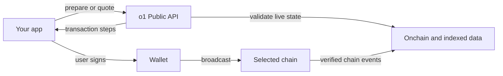

> ## Documentation Index
> Fetch the complete documentation index at: https://docs.o1.exchange/llms.txt
> Use this file to discover all available pages before exploring further.

# Public API

> Read o1 Launchpad data and prepare safe wallet transactions on Base, Robinhood, Monad, Arc, BSC, X Layer and Elysium.

The o1 Launchpad Public API exposes the useful actions available in the live application without exposing internal analytics, governance, or infrastructure controls.

This reference covers all six public API chains in the shared registry. Read `/config` for the selected chain and product before preparing transactions: chain support does not mean every quote is registered or launch creation is enabled.

It supports:

* Base mainnet (`8453`), Robinhood Chain (`4663`), Monad (`143`), Arc mainnet (`5042`), BSC (`56`), X Layer (`196`) and Elysium (`99901`)
* token browsing, search, creator launches, details, trades, announcements, holders, wallets, and fee claims
* crypto-paired token creation on Base, Robinhood, Monad, Arc, BSC, X Layer and Elysium plus registered stock-paired creation on Base, Robinhood, BSC, Monad and X Layer, with editable metadata, IPFS uploads, and the required `01` token-address suffix
* optional atomic Dev Buy using native currency or an admitted paired asset, with approval and repreparation for ERC-20 funding
* Base and Robinhood \$O launches paired with wstO, with ETH or held-wstO Dev Buy and ETH, chain-specific stablecoin, \$O or wstO trading
* exact-input launch-pool quotes and unsigned transaction preparation through the configured router, including SwapX on Arc, BSC, X Layer and Elysium
* fee claims, Tax dividend discovery and holder-authorized claim preparation, creator announcements, and authorized metadata updates

> [!WARNING]
>
> The API never signs or broadcasts an on-chain transaction. It returns explicit transaction steps for the requested wallet to review, sign, and submit.

## Chain and product support

| Chain | Chain ID | Standard API | Tax API deployment | \$O launches |
| - | -: | - | - | - |
| Base | `8453` | Supported | `base-mainnet-tax-token-v2` | `base-mainnet-wsto-burn-v1` |
| Robinhood | `4663` | Supported | `robinhood-mainnet-tax-token-v2` | `robinhood-mainnet-wsto-burn-v1` |
| Monad | `143` | Supported | `monad-mainnet-tax-token-v2` | Not supported |
| Arc | `5042` | Supported | `arc-mainnet-tax-token-v2` | Not supported |
| BSC | `56` | Supported | `bsc-mainnet-tax-token-v2` | Not supported |
| X Layer | `196` | Supported | `xlayer-mainnet-tax-token-v2` | Not supported |
| Elysium | `99901` | Supported | `elysium-mainnet-tax-token-v2` | Not supported |

Use `launch_product=tax` in configuration queries and `launch_product: "tax"` in launch bodies for Tax. Use `wsto` for **\$O launches on Base or Robinhood** (`base-mainnet-wsto-burn-v1` or `robinhood-mainnet-wsto-burn-v1`), with wstO as the paired asset. Omitted product selection means Standard (`non-tax`). Arc supports USDC and cirBTC; Elysium supports HYPE and USDC. Base, Robinhood, BSC, Monad and X Layer Standard/Tax support their registered crypto and stock pairs; Monad's are MON, USDC, WETH and wrapped xStocks.

Read the selected suite's `token_mode`, `tax_format`, `dividend_claims` and `creation_available` from `/config`. Standard Base tokens use B20; current Tax tokens use ERC-20. Frontend visibility flags do not control API access. Historical index-only Tax suites stay excluded from public API discovery and transaction preparation.

All six chains share read, configuration, fee-claim, creator-action and supported transaction-preparation endpoints. Dividend actions require a Tax token with dividends enabled. Atomic Dev Buy and alternative swap settlement use the routes advertised by `/config`, with live binding, balance, allowance and full-transaction simulation checks. Exact-output swaps and arbitrary caller-supplied routes are not exposed.

Funding and settlement assets are separate from the pool quote. Discover them through [configuration](https://docs.o1.exchange/launchpad/api/read-endpoints.md#dev-buy-and-settlement-assets), then follow [launch preparation](https://docs.o1.exchange/launchpad/api/launches.md) or [trade preparation](https://docs.o1.exchange/launchpad/api/trading.md). A configured route still needs sufficient liquidity for the requested amount.

## Base URL

```text theme={null}
https://api.launch.o1.exchange/v1
```

Only `GET /health` is unauthenticated. Send `x-api-key` on every other request.

## Resource model

The API keeps related data together without mixing incompatible query modes:

* `/config` combines production chains, contract configurations, paired assets, and capabilities. Its exact response field names remain `suites` and `quotes` for API compatibility.
* `/tokens` browses and ranks launches, `/tokens/search` searches them, and `/creators/{address}/tokens` lists one creator's launches.
* one token detail endpoint can include pool, market, and recent announcements.
* trades and announcements have independent collection routes and cursors.
* fee claims expose their own state and filters; holder Dividend positions and preparation use separate routes.
* on-chain name, symbol, and key-value updates are separate from token metadata-document updates that pin IPFS content.

This keeps the API compact while ensuring every parameter displayed for an endpoint is valid for that resource.

## Non-custodial transaction flow



Every prepare response identifies the expected chain, sender, destination, calldata, value, expiry, issues, and ordered prerequisites. Never replace an API-provided spender or destination with a guessed address.

The existing launchpad indexer discovers confirmed chain events normally. Public clients cannot ask the API to write product records or force an indexing job.

## Next

> [card] [Get an API key](https://launch.o1.exchange/developers)
>
> Create and manage a scoped production key with your wallet.

> [card] [Quickstart](https://docs.o1.exchange/launchpad/api/quickstart.md)
>
> List launches and prepare your first trade.

> [card] [Authentication](https://docs.o1.exchange/launchpad/api/authentication.md)
>
> Create keys, select scopes, and configure browser origins.

> [card] [Read endpoints](https://docs.o1.exchange/launchpad/api/read-endpoints.md)
>
> Search and paginate launchpad resources.

> [card] [Errors and rate limits](https://docs.o1.exchange/launchpad/api/errors-and-limits.md)
>
> Handle API errors, quotas, and safe retries.

> [card] [OpenAPI schema](https://docs.o1.exchange/launchpad-api-openapi.yaml)
>
> Download the complete machine-readable schema.


This documentation is built and hosted on [Mintlify](https://mintlify.com), a developer documentation platform.